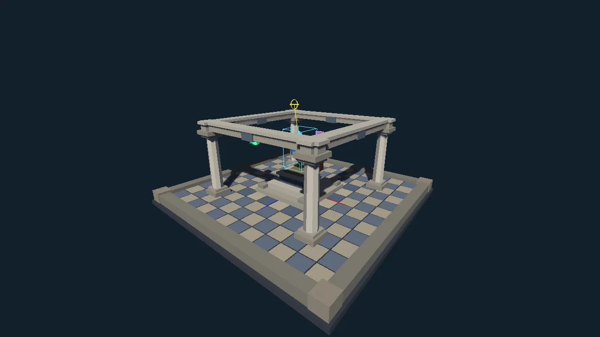

`rd::ShadowFeature` est un plugin qui tient à jour un atlas d'ombres : des cascades pour la première lumière
directionnelle ombrée et une vue par projecteur ombré. En mode `kCached`, la géométrie fixe est dessinée une fois dans un
cache ; quand rien ne bouge, rien n'est redessiné. Il faut trois choses : le plugin, des objets qui projettent (casters)
et des matériaux qui reçoivent.

Dans le code : `namespace rd = orosmo::renderer;`.

## Exemple minimal

```cpp
// 1. Le plugin, avant de compiler les programmes de maillage
auto shadows = rd::ShadowFeature::create(**device, shaders, pipelines, shaderDir);
if (!shadows) { /* erreur */ }
auto added = (*scene)->addFeature(std::move(*shadows));
if (!added) { /* erreur */ }
auto *shadowFeature = static_cast<rd::ShadowFeature *>(*added);

// 2. La lumière ombrée
rd::Light sun = rd::directionalLight({0.4f, 0.8f, 0.3f}, {1.0f, 0.96f, 0.9f}, 1.0f);
sun.mobility = rd::LightMobility::kDynamic;
sun.shadowMode = rd::ShadowMode::kCached;      // défaut kNone : pas d'ombre
lights.addLight(sun);
(void)lights.upload();
shadowFeature->setLights(&lights);             // non possédé

// 3. Les récepteurs : variante OROSMO_SHADOWS de mesh.frag et groupe 1 des ombres
auto receiver = shadowFeature->receiverProgramWith(meshDefines);   // meshDefines : forward+, AOV...
ground.setProgram(*receiver);
ground.setMaterialGroup(shadowFeature->receiverGroup());
structure.setProgram(*receiver);
structure.setMaterialGroup(shadowFeature->receiverGroup());

// 4. Les casters : maillage, boîte locale (culling par vue d'ombre), mobilité
auto id = shadowFeature->addMeshCaster(structure, structureBounds, rd::CasterMobility::kStatic);
if (!id) { /* kUnsupported : maillage à données d'instance */ }
```

Adapté de `Game::init` et `DemoScene::init` ([`apps/demo/src/Game/Game.cpp`](https://github.com/TimotheSandt/Orosmo/blob/dev/apps/demo/src/Game/Game.cpp),
[`apps/demo/src/Scene/demo_scene.cpp`](https://github.com/TimotheSandt/Orosmo/blob/dev/apps/demo/src/Scene/demo_scene.cpp)).
Dans la démo :

```bash
apps/demo/bin/debug/main --shadows on
```



Capture de la démo avec `--shadows on`.

Un objet peut recevoir sans projeter (le sol de la démo) ou projeter sans recevoir. Les casters et la `LightManager` ne sont
pas possédés : gardez-les vivants, et appelez `removeCaster(id)` avant de détruire un maillage enregistré.

## Matériaux PBR récepteurs

Pour un `PbrMaterial`, passez le plugin à la création : il ajoute les liaisons des ombres au groupe du matériau et le bit
`kPbrShadows` à sa variante. Un modèle glTF le fait avec `RenderModelOptions::shadows`.

```cpp
auto material = rd::PbrMaterial::create(**device, desc, *defaults, shadowFeature);
mesh.setMaterialGroup((*material)->group());
mesh.setProgram(*pbrShaders.program((*material)->features(), extraDefines));
```

Un matériau qui a ses propres textures (hors PBR) ajoute les liaisons 6 et 7 à son groupe par
`appendReceiverBindings(desc)`.

## Mobilité et mode d'ombre

La lumière porte `mobility` (`LightMobility`) et `shadowMode` (`ShadowMode`). Le caster porte `CasterMobility` :
`kStatic` (gardé dans le cache) ou `kMovable` (redessiné par-dessus le cache quand il bouge).

| Mobilité de la lumière \ mode | `kNone` | `kBaked` | `kDynamic` | `kCached` |
|---|---|---|---|---|
| `kStatic` (rien ne change) | pas d'ombre | repli `kCached` (pas de cuisson) | tout redessiné à chaque mise à jour | fixe en cache, mobiles par-dessus |
| `kStationary` (couleur seule) | pas d'ombre | repli `kCached` | idem | idem |
| `kDynamic` (tout, défaut) | pas d'ombre | invalide : repli `kDynamic` | idem | cache invalidé à chaque changement |

Une lumière `kStatic` qui bouge ou change de couleur, ou `kStationary` qui bouge, est comptée dans
`ShadowStats::mobilityViolations` et avertie dans le journal ; l'ombre reste juste. `lightStatus(index)` donne le résultat
pour une lumière (`ShadowStatus` : `kRealtime`, `kBakedFallback`, `kUnsupportedType` pour une ponctuelle, `kAtlasFull`…).

## Réglages

| Option (`ShadowSettings`) | Type | Défaut | Effet |
|---|---|---|---|
| `atlasSize` | `uint32_t` | `4096` | Côté de l'atlas (puissance de deux) ; le cache a la même taille. |
| `minTileSize` | `uint32_t` | `64` | Taille minimale d'une tuile avant abandon de la vue. |
| `cascadeCount` | `uint32_t` | `4` | Cascades du soleil, 1 à 4. |
| `cascadeResolution` | `uint32_t` | `1024` | Résolution d'une cascade. |
| `maxDistance` | `float` | `80` | Portée des ombres du soleil depuis la caméra (m). |
| `splitLambda` | `float` | `0.75` | Découpage des cascades : 0 uniforme, 1 logarithmique. |
| `fadeFraction` | `float` | `0.1` | Fondu sur la dernière fraction de `maxDistance`. |
| `depthExtension` | `float` | `60` | Casters pris en compte vers la lumière hors de la cascade (m). |
| `cascadeUpdateInterval` | `array<uint32_t, 4>` | `{1, 1, 2, 4}` | Une cascade n'est mise à jour qu'une image sur N. |
| `maxViewUpdatesPerFrame` | `uint32_t` | `8` | Budget de vues redessinées par image. |
| `pcfRadius` | `int` | `1` | Filtrage PCF sur (2r + 1)² texels. |
| `constantBias`, `slopeBias` | `float` | `1`, `1.5` | Biais en texels (le second × tan de l'angle). |
| `normalOffset` | `float` | `1` | Décalage du récepteur le long de la normale (texels). |
| `spotResolution` | `uint32_t` | `1024` | Résolution d'un projecteur proche. |
| `maxSpotShadows` | `uint32_t` | `8` | Projecteurs ombrés au plus. |

Les réglages se passent à `ShadowFeature::create(..., settings)` ou à `setSettings`. Un changement de `atlasSize` recrée
l'atlas : `receiverGroup()` change, et chaque maillage ou matériau doit être remis à jour (`PbrMaterial::rebuild`,
`RenderModel::rebuildMaterials`).

Par lumière, `setLightParams(index, params)` règle `LightShadowParams` : `priority` (`0`, plus grand servi d'abord),
`maxResolution` (`0` : celle par défaut), et pour un projecteur `spotNear` (`0.1`), `spotRange` (`30`), `fadeStart`
(`40`) et `fadeEnd` (`50`, au-delà plus d'ombre).

## Statistiques

`shadowFeature->stats()` rend un `ShadowStats` de la dernière image : `views`, `viewsUpdated`, `staticRedraws`,
`movableRedraws`, `cacheCopies`, `cacheHits`, `deferred`, `dropped`, `renderPasses`, `drawCalls`… Sur une image où rien ne
bouge en mode `kCached`, `viewsUpdated`, `renderPasses` et `drawCalls` valent 0. La démo les journalise.

## Ombres des objets transparents

Un caster maillage projette par défaut une ombre pleine. `setCasterTransparency(id, {mode, alpha, cutoff})` change ce
comportement par caster (`TransparentShadowMode`) :

| Mode | Ombre | Usage |
|---|---|---|
| `kNone` | aucune | lueurs additives, particules |
| `kFull` (défaut) | pleine, `alpha` ignoré | verre très opaque |
| `kMasked` | pleine si `alpha >= cutoff`, sinon aucune | feuillage, grillages |
| `kDithered` | part d'ombre ≈ `alpha` (trame de Bayer 4×4) | verre, fumée |

`rd::defaultTransparentShadowMode(blendMode)` donne le mode conseillé pour un `BlendMode`, mais n'est jamais appliqué tout
seul. Un caster dont l'opacité s'anime doit être `kMovable`, sinon tout le cache de la vue est redessiné. Démo :
`--scene mixed --shadows on --transparent-shadow dithered`.

## Limites

- REN-08 (Partiel) : pas d'ombres de contact ni de fondu entre cascades ; le cache d'une cascade est redessiné dès que la
  caméra bouge d'un texel (G156).
- REN-09 (Absent) : pas d'ombres des lumières ponctuelles (cubemaps) ni de pénombre variable ; une seule directionnelle
  ombrée.
- `kBaked` n'a pas de cuisson (REN-16) : repli temps réel.
- G157 : opacité par objet, pas par texel ; les objets instanciés projettent une ombre pleine ; pas d'ombre colorée.
- G199 : les foules (`CrowdRenderer`) ne projettent pas d'ombre.

État détaillé : [État du projet](/projet/etat/).

## Voir aussi

- [Lumières](/guides/rendu-3d/lumieres/)
- [Objets transparents](/guides/rendu-3d/transparence/)
- [Instancing et culling](/guides/rendu-3d/instancing-culling/) (`addObjectCasters`)
