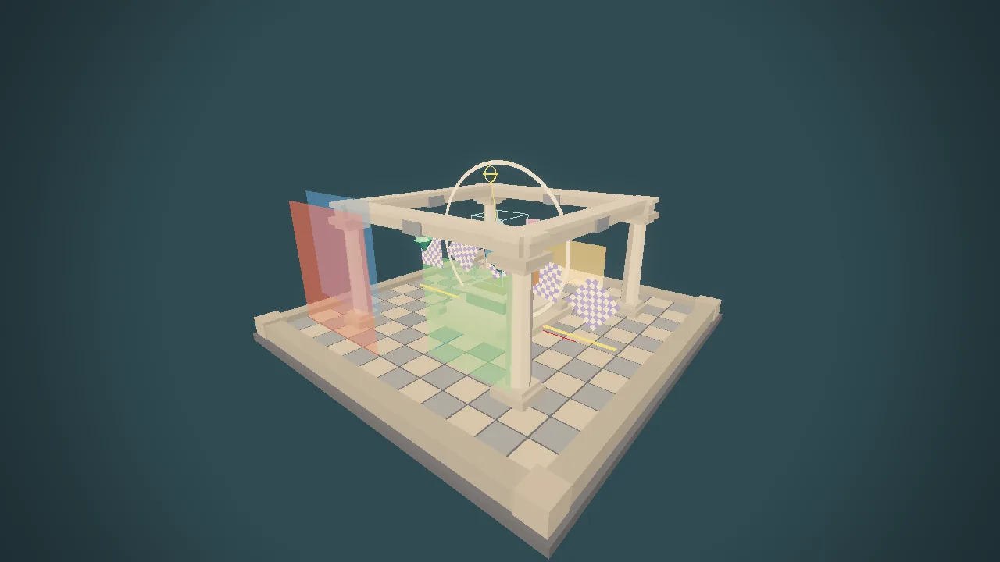

Chaque effet de post-traitement est un plugin du graphe de passes (`rd::PostEffect`), activable à l'exécution par
`setEnabled`. Ils s'exécutent après les passes de la scène, à la résolution de rendu, avant la mise à l'échelle et
l'interface. `rd::addPostEffects` les crée tous les cinq, dans l'ordre conseillé.

Dans le code : `namespace rd = orosmo::renderer;`, `namespace rhi = orosmo::rhi;`.

## Exemple minimal

```cpp
auto fx = rd::addPostEffects(**scene, **device, shaders, pipelines, shaderDir); // cinq effets, tous désactivés
if (!fx) { /* erreur */ }
fx->tonemap->setEnabled(true);
fx->tonemap->settings().tonemapper = rd::Tonemapper::kAces;
fx->bloom->setEnabled(true);
fx->bloom->settings().threshold = 0.8f;
fx->bloom->settings().intensity = 0.15f;
if (auto r = fx->sync(**scene); !r) { /* erreur */ }  // scène en RGBA16F au prochain beginFrame
```

Adapté de `Game::createPostEffects` ([`apps/demo/src/Game/Game.cpp`](https://github.com/TimotheSandt/Orosmo/blob/dev/apps/demo/src/Game/Game.cpp)).
Dans la démo :

```bash
apps/demo/bin/debug/main --scene mixed --post full     # none (défaut), hdr, bloom ou full
```

`hdr` = tonemapping ACES ; `bloom` = en plus le bloom ; `full` = en plus l'exposition automatique, une LUT chaude calculée
et le vignettage.



Capture de la démo avec `--scene mixed --post full`.

`PostEffects::sync` met la scène en `kRGBA16Float` seulement si un effet HDR est actif (exposition automatique, bloom,
tonemapping) et la remet en `kRGBA8Unorm` sinon. Appelez-le après chaque changement d'activation.

## Couleur : linéaire, sRGB et image trop sombre

Les shaders de maillage (`mesh.frag`, `mesh_pbr.frag`) écrivent une couleur linéaire, et rien ne la convertit en sRGB avant
l'écran : le backbuffer OpenGL est linéaire (le backend coupe la conversion sRGB). La seule conversion est
`TonemapSettings::encodeSrgb`, vraie par défaut. Conséquence : sans `TonemapFeature`, un modèle PBR dont les textures sont
correctement chargées en sRGB s'affiche plus sombre et plus contrasté que dans un visualiseur glTF, sans aucune erreur.

Pour une image juste :

1. charger les textures de couleur (couleur de base, émission) en sRGB et les cartes de données en linéaire
   (`assets::TextureRole`, voir [Matériaux PBR](/guides/rendu-3d/materiaux-pbr/)) ;
2. passer la scène en HDR ;
3. ajouter `TonemapFeature`, qui expose, compresse et encode en sRGB.

Sans `addPostEffects`, le tonemapping seul s'installe ainsi :

```cpp
(void)(*scene)->setSceneColorFormat(rhi::Format::kRGBA16Float);          // scène HDR
auto post = rd::PostContext::create(**device, shaders, pipelines, shaderDir);
if (!post) { /* erreur */ }
auto tonemap = rd::TonemapFeature::create(*post);                         // activé, encodeSrgb = true
if (!tonemap) { /* erreur */ }
(void)(*scene)->addFeature(std::move(*tonemap));                          // après les plugins de la scène, avant l'interface
```

:::note
La démo écrit des couleurs de sommets pensées en sRGB et les traite comme linéaires : avec `--post`, son image est donc
plus claire qu'en `--post none` (G158). Ce n'est pas le comportement à reproduire avec des matériaux PBR.
:::

Les couleurs de l'interface (thèmes JSON, `#rrggbb`) ne passent pas par ce chemin : elles sont écrites telles quelles.

## Tonemapping

| Option (`TonemapSettings`) | Type | Défaut | Effet |
|---|---|---|---|
| `tonemapper` | `Tonemapper` | `kAces` | `kClamp` (bornage seul), `kAces`, `kAgx`, `kReinhardExtended`. |
| `exposureEv` | `float` | `0` | Compensation en EV (× 2^ev), multipliée par `FrameEnvironment::exposure` (défaut 1). |
| `whitePoint` | `float` | `4` | Luminance qui devient le blanc (Reinhard étendu seulement). |
| `encodeSrgb` | `bool` | `true` | Sortie encodée en sRGB ; faux : sortie linéaire. |
| `useAutoExposure` | `bool` | `true` | Multiplie par l'exposition de `AutoExposureFeature` si elle est active. |

`rd::parseTonemapper("aces")` accepte `clamp`, `aces`, `agx` et `reinhard`. L'exposition globale se règle aussi par
`(*scene)->setFrameEnvironment(env)` avec `env.exposure`.

## Bloom

| Option (`BloomSettings`) | Type | Défaut | Effet |
|---|---|---|---|
| `threshold` | `float` | `1` | Luminance à partir de laquelle un pixel rayonne. |
| `knee` | `float` | `0.5` | Douceur du seuil. |
| `intensity` | `float` | `0.08` | Part du bloom ajoutée à la scène. |
| `radius` | `float` | `1` | Rayon du filtre d'agrandissement (texels). |
| `maxLuminance` | `float` | `64` | Luminance maximale prise en compte (évite les points scintillants). |
| `levels` | `uint32_t` | `5` | Niveaux de réduction, 1 à 8. |

## Exposition automatique

Mesure un histogramme de luminance en compute. `fx->autoExposure` est nul si le périphérique n'a pas de compute ; les
autres effets marchent sans lui. L'adaptation lit la durée de l'image donnée par `(*scene)->setDeltaTime(dt)` ; sans cet
appel (durée 0), l'exposition saute directement à la valeur visée.

| Option (`AutoExposureSettings`) | Type | Défaut | Effet |
|---|---|---|---|
| `minLog2`, `maxLog2` | `float` | `-10`, `6` | Plage de luminance mesurée (log2). |
| `key` | `float` | `0.18` | Gris moyen visé : exposition = key / luminance moyenne. |
| `minEv`, `maxEv` | `float` | `-6`, `6` | Bornes de l'exposition. |
| `adaptationSpeed` | `float` | `1.5` | Vitesse d'adaptation par seconde ; `<= 0` : immédiat. |

`resetAdaptation()` part de l'exposition visée à l'image suivante (changement de scène). `readExposure()` lit l'état
(bloquant, pour le debug).

## Étalonnage par LUT

```cpp
std::string text = /* contenu d'un fichier .cube */;
auto lut = rd::parseCubeLut(text);                 // LUT_3D_SIZE N, 2 à 256 ; LUT 1D refusée
if (!lut) { /* kInvalidArgument ou kUnsupported */ }
if (auto r = fx->colorGrading->setLut(*lut); !r) { /* valeurs hors [0, 1] : l'ancienne LUT reste */ }
fx->colorGrading->setStrength(0.8f);               // 0 : image inchangée, 1 : LUT entière (défaut)
fx->colorGrading->setEnabled(true);
```

La LUT de départ est l'identité 16³ ; `rd::identityLut(size)` en crée une à modifier par le code (la démo calcule ainsi sa
LUT chaude). L'étalonnage travaille sur les valeurs affichées, après le tonemapping, et n'exige pas de scène HDR.

## Vignettage

| Option (`VignetteSettings`) | Type | Défaut | Effet |
|---|---|---|---|
| `intensity` | `float` | `0.35` | Assombrissement maximal (1 : noir dans les coins). |
| `radius` | `float` | `0.55` | Distance normalisée où l'assombrissement commence. |
| `softness` | `float` | `0.45` | Largeur de la transition. |
| `roundness` | `float` | `1` | 1 : cercle ; 0 : ellipse qui suit le cadre. |

## Ordre des effets

L'ordre des passes est l'ordre d'enregistrement. `addPostEffects` enregistre : exposition automatique, bloom, tonemapping,
étalonnage, vignettage. Enregistrez-le après les plugins qui complètent la scène (transparents, 2D dans le monde), après le
TAA, et avant FXAA ou SMAA et l'interface (voir [Anticrénelage](/guides/rendu-3d/anticrenelage/)). La démo retire puis
réenregistre son plugin d'interface (`removeFeature`) pour qu'il reste le dernier.

## Limites

- REN-20 (Absent) : pas de profondeur de champ, de flou de mouvement ni d'upscaling type FSR.
- G158 : chaque effet qui relit la scène recopie son résultat (pas de ping-pong) ; exposition automatique sans
  pondération centrale ; pas de sortie HDR vers l'écran (PQ, scRGB).

État détaillé : [État du projet](/projet/etat/).

## Voir aussi

- [Anticrénelage](/guides/rendu-3d/anticrenelage/)
- [Textures](/guides/contenus/textures/)
- [Options de la démo](/reference/options-demo/)
