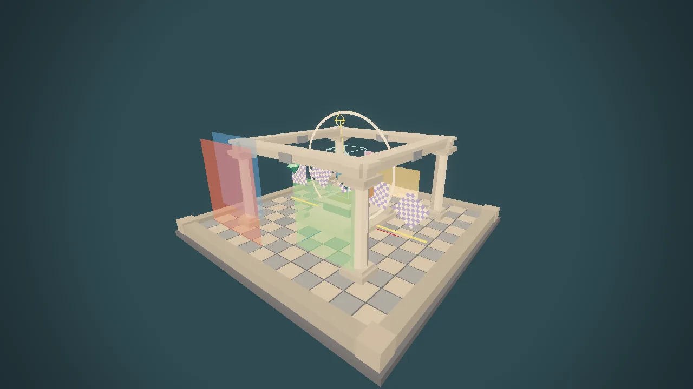

Un objet transparent se dessine après les opaques, sans écrire la profondeur, et les objets mélangés doivent être triés
de l'arrière vers l'avant. `rd::TransparentFeature` fait ce tri : on lui dépose les objets de l'image, il les dessine dans
une passe `transparents` juste après la passe `scene`.

Les exemples suivent les noms de [Dessiner une scène](/guides/rendu-3d/scene/#noms-utilisés-dans-les-exemples) (`device`, `renderer`, `shaders`, `pipelines`, `shaderDir`, `lights`).

## Exemple minimal

```cpp
// Une fois : le plugin, après les ombres et avant les post-traitements
auto created = rd::TransparentFeature::create(device, shaders, pipelines, shaderDir);
if (!created) { /* erreur */ }
auto added = renderer.addFeature(std::move(*created));
if (!added) { /* erreur */ }
auto *transparents = static_cast<rd::TransparentFeature *>(*added);

// À chaque image, entre setCamera et endFrame
const rd::TransparentMaterial glass{.mode = rd::BlendMode::kBlend, .alpha = 0.45f};
for (rd::Mesh &pane : panes) {
    if (auto r = transparents->submit(renderer, pane, glass); !r) { /* erreur */ }
}
if (auto r = transparents->submit(renderer, glow, {.mode = rd::BlendMode::kAdditive, .alpha = 0.6f}); !r) { /* erreur */ }
```

Adapté de `MixedScene` ([`apps/demo/src/Scene/mixed_scene.cpp`](https://github.com/TimotheSandt/Orosmo/blob/dev/apps/demo/src/Scene/mixed_scene.cpp)).
Dans la démo :

```bash
apps/demo/bin/debug/main --scene mixed
```



Capture de la démo avec `--scene mixed --post full` : trois vitres triées et une lueur additive.

Les maillages déposés utilisent la disposition de `mesh.vert` (position, normale, couleur : `attributeSizes = {3, 3, 3}`) ;
le plugin remplace leur programme par le sien (`mesh.frag` compilé avec `OROSMO_TRANSPARENT`). Les dépôts valent pour une
seule image : on redépose chaque image. Un même maillage peut être déposé plusieurs fois avec des poses différentes.

## Modes de fusion

| `BlendMode` | Formule ou effet | Profondeur écrite | Trié |
|---|---|---|---|
| `kOpaque` | aucun mélange | oui | non |
| `kMask` | pixel rejeté si `alpha < cutoff` | oui | non |
| `kMaskA2C` | comme `kMask` aujourd'hui (pas d'alpha-to-coverage) | oui | non |
| `kDithered` | part de pixels gardés ≈ `alpha`, trame 4×4 | oui | non |
| `kBlend` | `src × a + dst × (1 − a)` | non | oui |
| `kAdditive` | `src × a + dst`, dessiné après les mélangés | non | à part, après les mélangés |
| `kPremultiplied` | `src + dst × (1 − a)` | non | oui |
| `kTransmission` | composé comme `kBlend` (pas de réfraction) | non | oui |

`rd::blendModeState(mode)` donne l'état de pipeline d'un mode ; `rd::blendModeName` et `rd::blendModeFromName` font la
conversion avec les noms `"opaque"`, `"mask"`, `"mask_a2c"`, `"dithered"`, `"blend"`, `"additive"`, `"premultiplied"`,
`"transmission"`.

## Réglages d'un dépôt

| Option (`TransparentMaterial`) | Type | Défaut | Effet |
|---|---|---|---|
| `mode` | `BlendMode` | `kBlend` | Mode de fusion. |
| `alpha` | `float` | `1` | Opacité (mélange), part de pixels gardés (`kDithered`), valeur comparée au seuil (`kMask`). |
| `cutoff` | `float` | `0.5` | Seuil de `kMask` et `kMaskA2C`. |
| `priority` | `int32_t` | `0` | L'emporte sur la distance : petite valeur dessinée d'abord, donc dessous. |
| `centerOffset` | `glm::vec3` | `(0, 0, 0)` | Centre de tri, relatif à `Mesh::position` (grands objets). |

## Ordre de dessin

Dans la passe `transparents`, l'ordre est fixe :

1. `kOpaque`, `kMask`, `kMaskA2C`, `kDithered` : dans l'ordre de dépôt, profondeur écrite ;
2. `kBlend`, `kPremultiplied`, `kTransmission` : priorité, puis de l'arrière vers l'avant (distance du centre de l'objet à
   la caméra), sans écriture de profondeur ;
3. `kAdditive` : après les mélangés (priorité puis distance, pour un ordre stable), sans écriture de profondeur.

Le tri se fait par objet, pas par triangle : deux grands objets qui se croisent peuvent s'afficher dans le mauvais ordre.
`priority` ou `centerOffset` corrigent les cas fixes. `drawOrder()` rend l'ordre de la dernière image et `stats()` les
compteurs (`submitted`, `blended`, `additive`, `drawCalls`).

## Transparents dessinés par drawMesh

Un maillage dessiné par `SceneRenderer::drawMesh` peut aussi être mélangé : `mesh.setAovMaterial({rd::BlendMode::kBlend, {}})`
pose le mode de fusion de son pipeline. Il n'est alors pas trié (ordre des `drawMesh`) et son shader doit écrire l'alpha
(variante PBR `kPbrAlphaBlend`). C'est ce que fait `assets::RenderModel` pour les matériaux glTF `BLEND`.

Par défaut un transparent n'écrit aucune sortie auxiliaire (AOV : normales, identifiant, mouvement). Le deuxième champ de
`AovMaterial` les demande explicitement, par exemple pour la sélection à la souris :

```cpp
mesh.setAovMaterial({rd::BlendMode::kBlend, rd::AovSet{rd::Aov::kObjectId}});
```

## Limites

- `kMaskA2C` se comporte comme `kMask` (le RHI n'a ni MSAA ni alpha-to-coverage) et `kTransmission` se compose comme
  `kBlend`, sans réfraction.
- Pas de transparence indépendante de l'ordre (OIT).
- Les objets instanciés n'écrivent pas de sorties auxiliaires.
- L'opacité et le seuil sont par objet, pas par texel ; les primitives glTF transparentes ne sont pas triées.

Détail et suivi : [État du projet](/projet/etat/).

## Voir aussi

- [Ombres des transparents](/guides/rendu-3d/ombres/)
- [Mélanger 2D et 3D](/guides/rendu-2d/melange-2d-3d/)
- [HDR et post-traitement](/guides/rendu-3d/post-traitement/)
